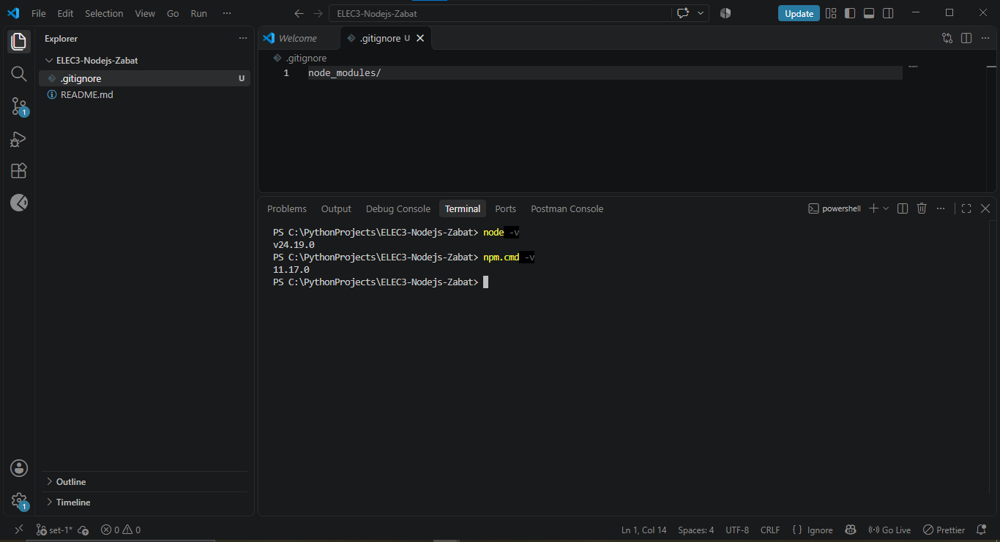
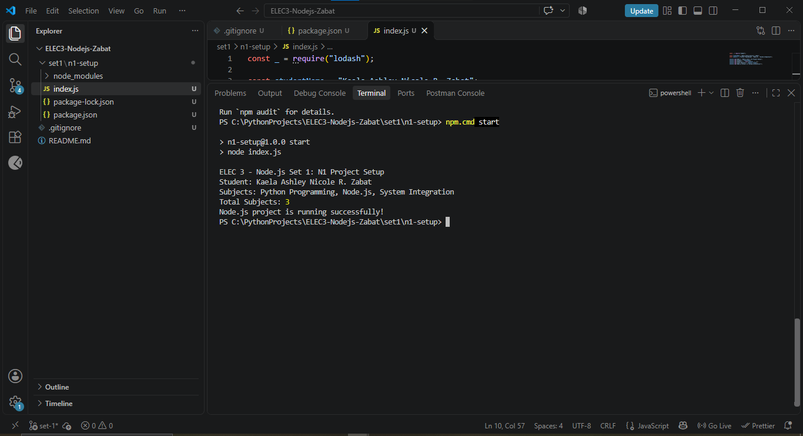
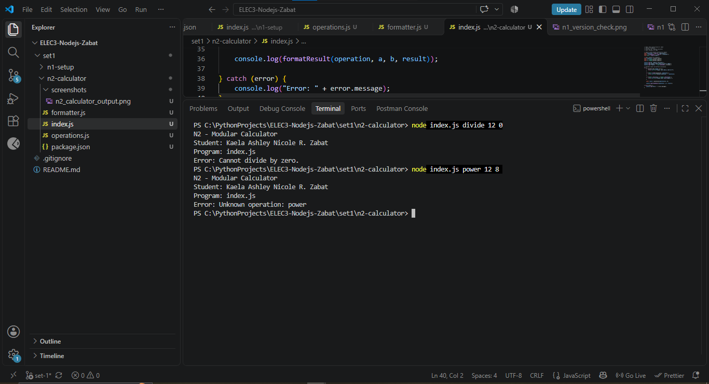
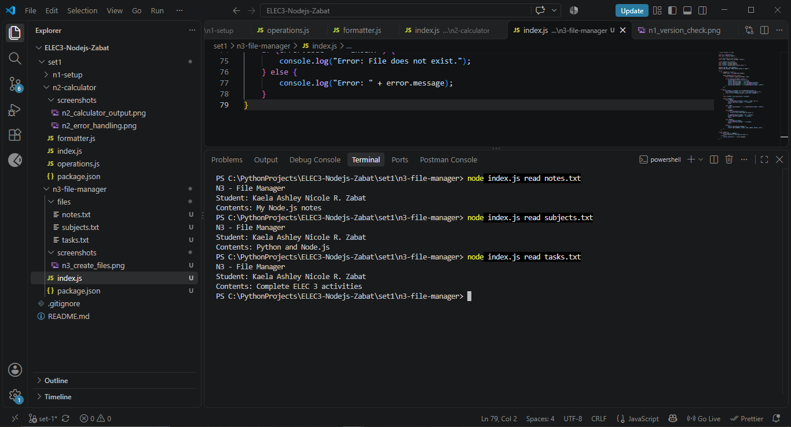
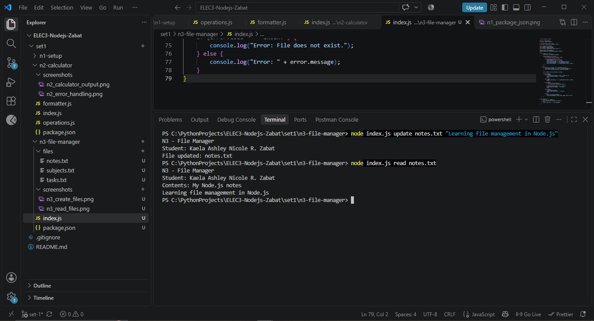
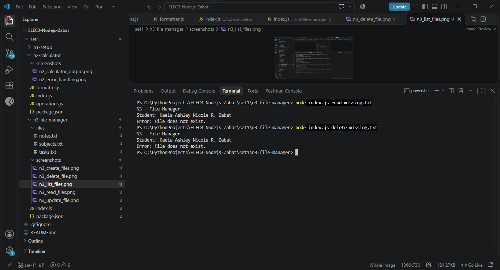

# ELEC3-Nodejs-Zabat

*Name:* Kaela Ashley Nicole R. Zabat
*Section:* IV-BSIT-C
*Course:* ELEC 3 - Node.js
*School:* Pangasinan State University - Lingayen Campus

## Set 1 - Activities

| Activity | Description | Folder |
|---|---|---|
| N1 | Node.js Project Setup and Package Management | [N1 Setup](set1/n1-setup) |
| N2 | Modular Calculator with Error Handling | [N2 Calculator](set1/n2-calculator) |
| N3 | File Manager using fs and path modules | [N3 File Manager](set1/n3-file-manager) |

## N1 - Project Setup

This activity demonstrates Node.js project initialization, package management, dependencies, and npm scripts.

### How to Run

cd set1/n1-setup
npm install
npm start

### Screenshots

*Version Check*

*Package JSON*

*Successful Output*

## N2 - Modular Calculator

This activity demonstrates JavaScript modules, command-line arguments, mathematical operations, and error handling.

### How to Run

cd set1/n2-calculator
node index.js add 12 8

### Screenshots

*Calculator Output*

*Error Handling*

## N3 - File Manager

This activity demonstrates creating, reading, updating, deleting, and listing text files using the built-in fs and path modules.

### How to Run

cd set1/n3-file-manager
node index.js create demo.txt "Hello Node.js"
node index.js read demo.txt
node index.js update demo.txt "Learning Node.js"
node index.js list
node index.js delete demo.txt
node index.js read missing.txt

### Screenshots

*Create Files*

*Read Files*

*Update File*

*Delete File*

*List Files*

*Error Handling*

