# ELEC3-Nodejs-Zabat

**Name:** Kaela Ashley Nicole R. Zabat  
**Section:** IV-BSIT-C  
**Course:** ELEC 3 - Node.js  
**School:** Pangasinan State University - Lingayen Campus

## Set 1 - Activities

| Activity | Description | Folder |
|---|---|---|
| N1 | Node.js Project Setup and Package Management | [N1 Setup](set1/n1-setup) |
| N2 | Modular Calculator with Error Handling | [N2 Calculator](set1/n2-calculator) |
| N3 | File Manager using fs and path modules | [N3 File Manager](set1/n3-file-manager) |

## N1 - Project Setup

This activity demonstrates Node.js project initialization, package management, dependencies, and npm scripts.

### How to Run

```bash
cd set1/n1-setup
npm install
npm start
```

### Screenshots

**Version Check**


**Package JSON**

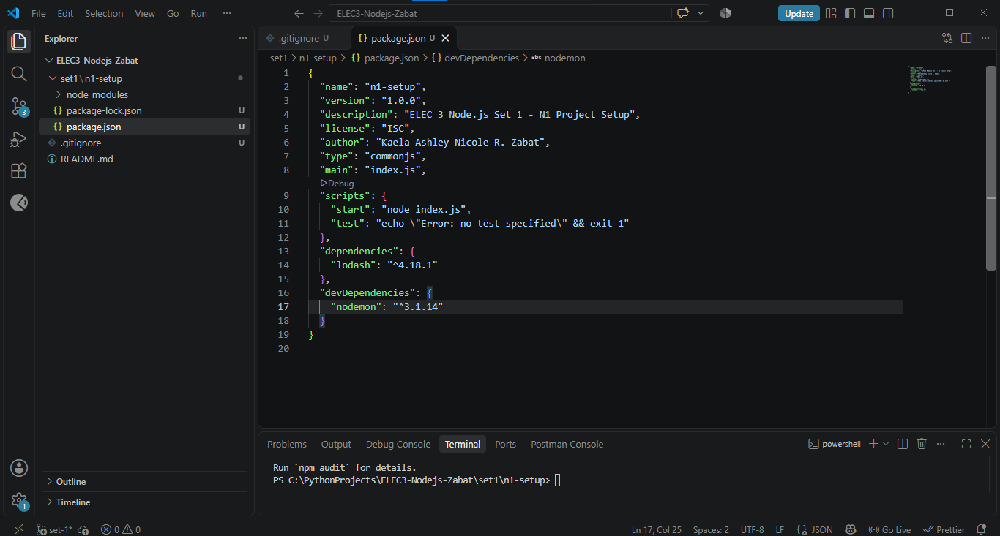

**Successful Output**


## N2 - Modular Calculator

This activity demonstrates JavaScript modules, command-line arguments, mathematical operations, and error handling.

### How to Run

```bash
cd set1/n2-calculator
node index.js add 12 8
```

### Screenshots

**Calculator Output**

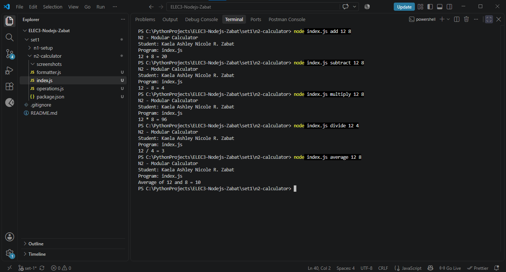

**Error Handling**


## N3 - File Manager

This activity demonstrates creating, reading, updating, deleting, and listing text files using the built-in fs and path modules.

### How to Run

```bash
cd set1/n3-file-manager
node index.js create demo.txt "Hello Node.js"
node index.js read demo.txt
node index.js update demo.txt "Learning Node.js"
node index.js list
node index.js delete demo.txt
node index.js read missing.txt
```

### Screenshots

**Create Files**

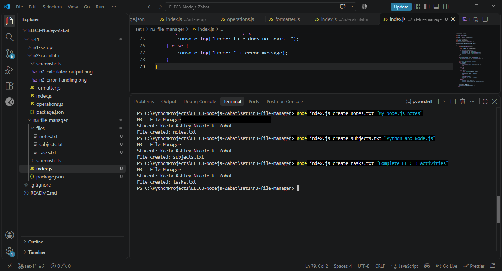

**Read Files**


**Update File**


**Delete File**

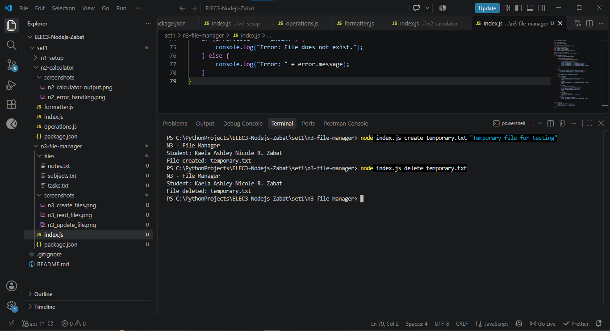

**List Files**

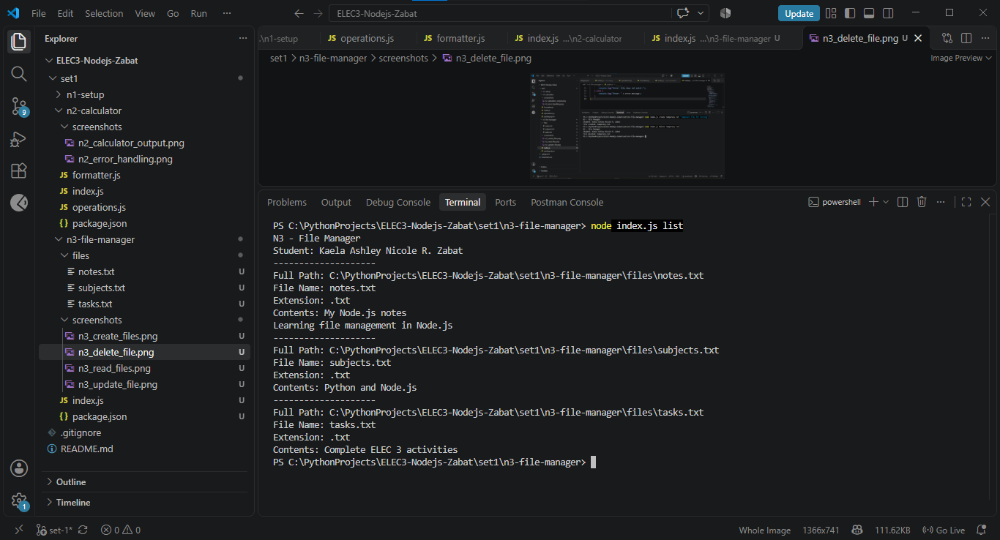

**Error Handling**


---

## Set 2 - Activities

| Activity | Description | Folder |
|---|---|---|
| N4 | Basic HTTP Server with Routing and Status Codes | [N4 Server](set2/n4-server) |
| N5 | HTTP Methods and Student REST API | [N5 API](set2/n5-api) |
| N6 | Middleware and API Testing | [N6 Middleware](set2/n6-middleware) |

## N4 - Basic HTTP Server

This activity demonstrates the creation of a basic HTTP server using the built-in Node.js HTTP module. It includes multiple routes, HTTP status codes, and Content-Type headers.

### How to Run

From the repository root:

```bash
node set2/n4-server/index.js
```

### Available Routes

| Route | Description | Status Code |
|---|---|---|
| / | Home page | 200 |
| /about | About page | 200 |
| /contact | Contact page | 200 |
| /invalid | Page not found | 404 |

Open http://localhost:8000 in a web browser.

### Screenshots

**Home Page**

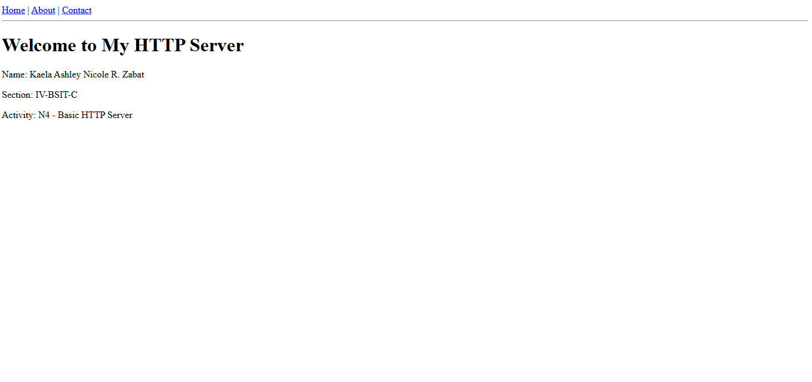

**About Page**


**Contact Page**


**404 Page Not Found**


## N5 - HTTP Methods and REST API

This activity demonstrates a Student REST API using the built-in HTTP module. It supports CRUD operations, JSON responses, appropriate status codes, and error handling.

Student records are stored in an array and reset when the server is restarted.

### How to Run

From the repository root:

```bash
node set2/n5-api/index.js
```

### API Endpoints

| Method | Endpoint | Description |
|---|---|---|
| GET | /api/students | Retrieve all students |
| GET | /api/students/:id | Retrieve one student |
| POST | /api/students | Add a new student |
| PUT | /api/students/:id | Update an existing student |
| DELETE | /api/students/:id | Delete a student |

API URL: http://localhost:8000/api/students

[API Documentation](set2/n5-api/README.md)

### Screenshot

**Student REST API Output**

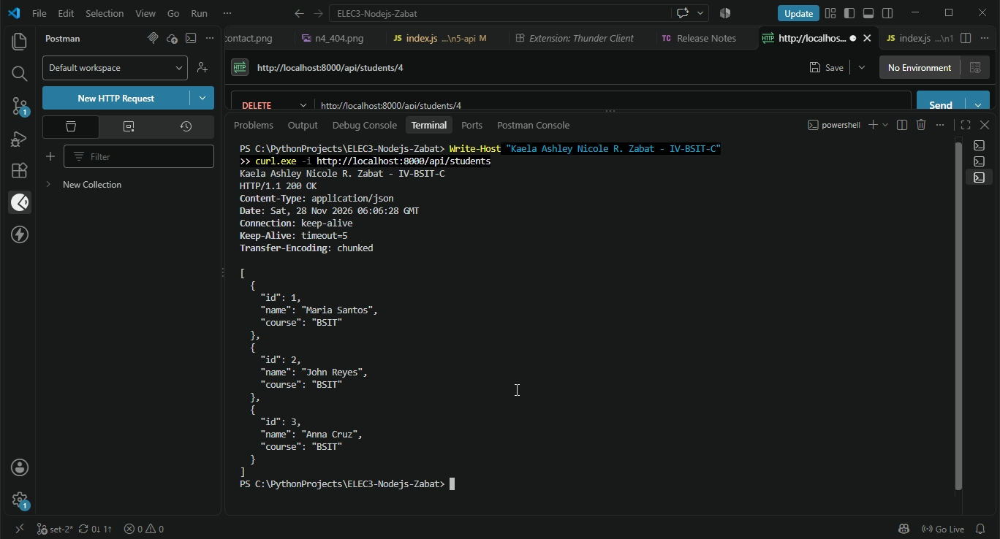

## N6 - Middleware and API Testing

This activity extends the Student REST API from N5 by implementing two custom middleware functions.

- Logger middleware records the date, time, HTTP method, and URL of each incoming request.
- JSON middleware automatically sets the Content-Type header to application/json.
- Both middleware functions use next() to continue processing the request.

All five API endpoints were tested using Postman in Visual Studio Code.

### How to Run

From the repository root:

```bash
node set2/n6-middleware/index.js
```

API URL: http://localhost:8000/api/students

### Written Answer

[N6 Written Answer](set2/n6-middleware/n6_answers.docx)

### Screenshots

**GET - Retrieve All Students**

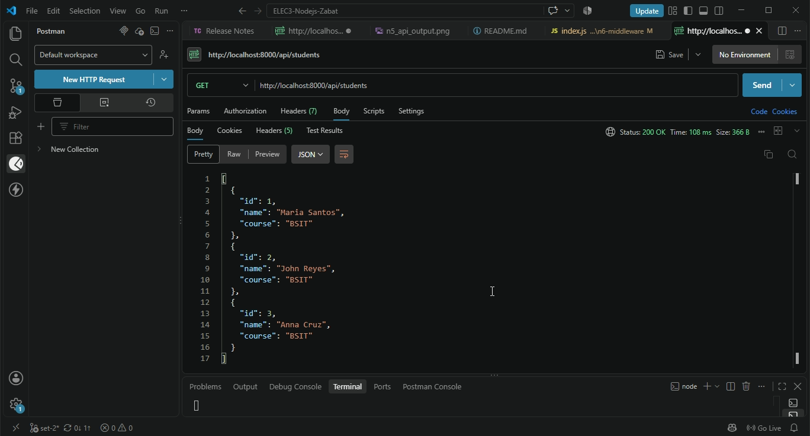

**GET - Retrieve One Student**

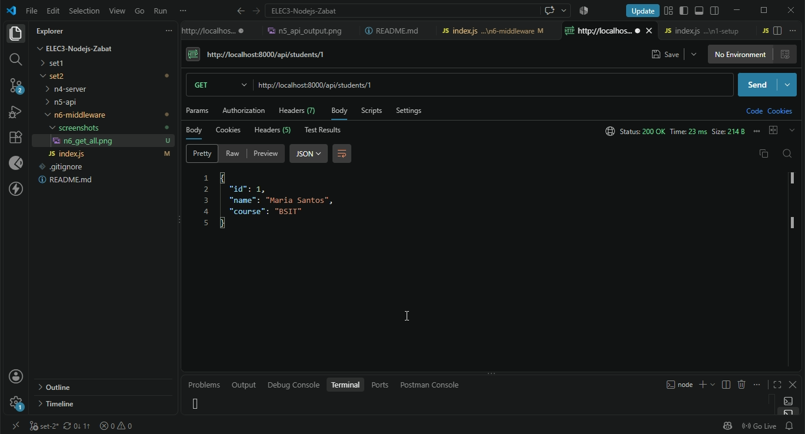

**POST - Add a Student**

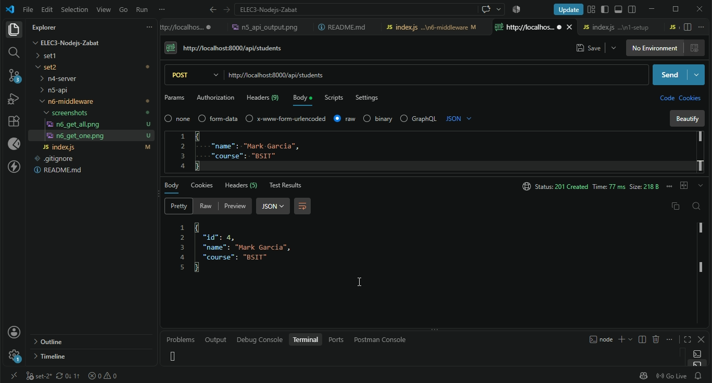

**PUT - Update a Student**

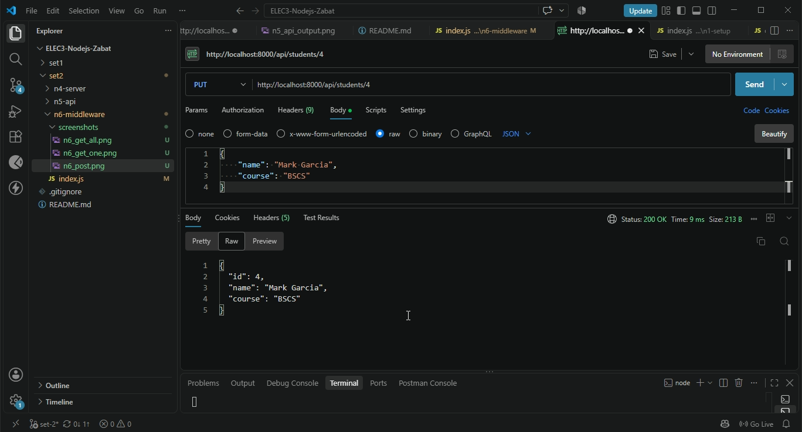

**DELETE - Remove a Student**

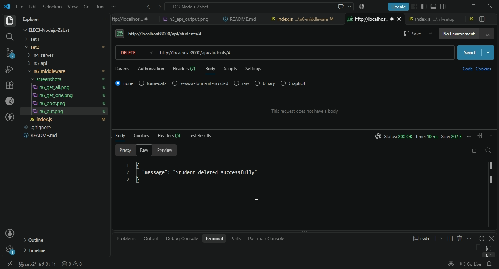

**Logger Middleware Output**

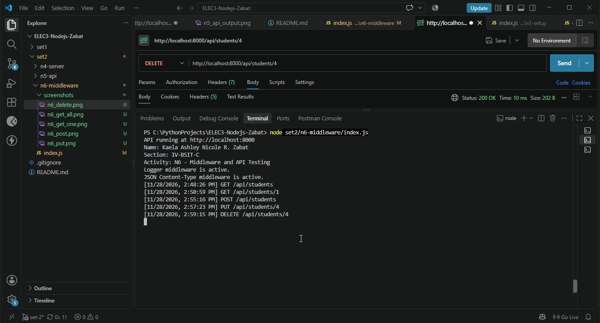

---

## Important Notes

- Node.js must be installed before running the activities.
- For N1, install the required dependencies using npm install.
- On Windows PowerShell, npm.cmd can be used if npm scripts are blocked by the execution policy.
- N4, N5, and N6 use the built-in Node.js HTTP module and do not require additional packages.
- Run only one HTTP server at a time because N4, N5, and N6 use port 8000.
- Press Ctrl+C to stop the running server.
- All screenshots are stored inside their respective activity folders.

## Completion Status

| Set | Activities | Status |
|---|---|---|
| Set 1 | N1, N2, N3 | Completed |
| Set 2 | N4, N5, N6 | Completed |
