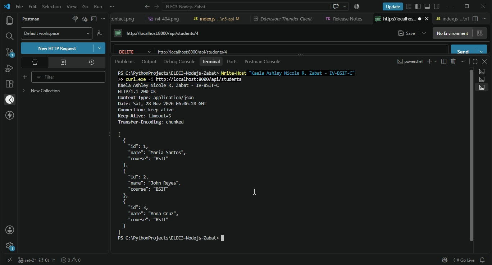

# N5 - HTTP Methods and REST API

**Name:** Kaela Ashley Nicole R. Zabat  
**Section:** IV-BSIT-C  
**Course:** ELEC 3 - Node.js  
**Date:** November 28, 2026

## Description

This activity demonstrates a simple Student REST API using the
built-in HTTP module of Node.js. It uses an array to store
student records and supports basic CRUD operations.

## API Endpoints

| Method | Endpoint | Description |
| --- | --- | --- |
| GET | /api/students | Retrieve all students |
| GET | /api/students/:id | Retrieve a specific student |
| POST | /api/students | Add a new student |
| PUT | /api/students/:id | Update an existing student |
| DELETE | /api/students/:id | Delete a student |

## HTTP Status Codes

- 200 OK - Successful request
- 201 Created - Student successfully added
- 400 Bad Request - Invalid request data
- 404 Not Found - Student or route not found

## How to Run

From the repository root, execute:

```bash
node set2/n5-api/index.js
```

API URL: http://localhost:8000/api/students

## Sample Request Body

```json
{
    "name": "Mark Garcia",
    "course": "BSIT"
}
```

## Testing

The API was tested using a web browser, Postman,
and curl in the VS Code terminal.

Student records are stored in memory and reset
when the server is restarted.

## Screenshot


